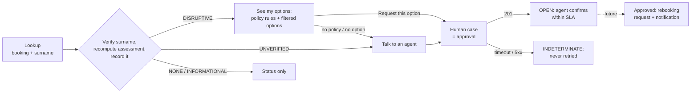

# Disruption Companion

Helps a passenger whose flight was disrupted understand what happened and what to do next, **without asserting unverified information and without executing a high-impact action without a person's approval**. Backend/Integration track: a Python service plus a minimal page; the airline systems are mocked with the brief's contracts.

## Run locally

**Prerequisites:** Docker with Compose v2, `make`, `openssl`, `curl`. No Python toolchain needed.

```bash
make env      # .env with random secrets (never overwrites; for an older .env see below)
make up       # db, migrate, api, mock-tools, fe; waits until healthy
make check    # ruff + import-linter layer contracts + unit tests (api and mock-tools)
make smoke    # the running stack end to end: headers, proxy, lookup, recommendation, cases
make down     # stop (make clean also deletes the database volume)
```

Page: `http://localhost:8080/`. API docs: `http://127.0.0.1:8000/docs` (when `ENABLE_DOCS=true`).
Every `/api` call needs `Authorization: Bearer <API_TOKEN>` from `.env`. The page never handles the token: add it with a header-modifier extension **scoped to `http://localhost:8080/*`**. An older `.env` without `TOOLS_API_TOKEN` stops `api` and `mock-tools`: run `rm .env && make env`.

## Demo scenarios

Use the last name **Silva** (case and accents ignored). Mock timestamps shift to the request time, so data stays fresh during a demo.

| Booking | Shows | Expected |
|---|---|---|
| `ABC123` | The brief's sample: partial context, degraded source contradicting OPS_CORE, 160-min delay | `DISRUPTIVE` (missed connection). Options: only O1 (O2 lacks seats for 2 and charges a fee; O3 refunds a non-refundable fare). Request O1 → case; again → same case |
| `CASERR` | `ABC123` whose case creation times out | Case `INDETERMINATE`: not retried, passenger told to call if no answer in 45 min |
| `CANC01` | First flight cancelled | `DISRUPTIVE`; no cancellation policy → "Talk to an agent" |
| `NITE01` | Delay pushes arrival past midnight | `DISRUPTIVE`: 00:30 next day misses 23:50 |
| `CONF01` / `STAL01` / `EVTERR` | Trusted sources disagree / only stale data / events tool down | `UNVERIFIED`: nothing asserted, "Talk to an agent" |
| `OKAY01` / `GATE01` | On time / gate change only | `NONE` / `INFORMATIONAL` |
| `NOTF01` / `CTXERR` | Unknown booking / trip tool down | 404 (same as a wrong surname) / 503 |

## How a request flows



Every call re-verifies the surname and recomputes on the server; the page only renders. Sources are trusted from each response's `_meta`, conflicts are never resolved by guessing, times are computed in UTC with airport time zones, relevance rules and the policy are versioned, and every assessment and case is recorded without personal data.

## What is automatic and what needs a person

| Step | Demo (this version) | Future |
|---|---|---|
| Trip status, relevance, explanation | Automatic, deterministic | Same; an LLM may reword, behind a verifier |
| Entitlements from the versioned policy | Automatic, deterministic (conditions parsed, never executed) | Same |
| Filtering and ranking options | Automatic: a proposal, never executed | Same |
| Opening a human case | Automatic on the passenger's request, deduplicated | Same |
| Rebook at no fee (R1/R3) | **Human approves** | Automatic when no rule needs approval, the option is HIGH confidence with seats for the party and no fee, and the data is fresh |
| Meal voucher (R2) | Human | Automatic |
| Priority handling (R5, a minor), cash compensation (R4) | Human | Human |
| Unverified status, cancellations without policy | Human | Human (cancellation automatic once a policy exists) |
| Unknown outcome of a write (timeout, 5xx) | Human reconciles; never retried | Same, plus a reconciliation job |
| Refund on a non-refundable fare, fee conflicts, splitting the party | Never offered | Never automatic |

## Tests and validation

Unit tests (pytest, TDD) cover every spec scenario with fakes and `httpx.MockTransport`; migrations run up and down on SQLite; import-linter enforces the layers, including "read-only services never see the write port". `make smoke` exercises the real PostgreSQL, nginx and mocks. **Known limitations:** no integration suite, the page is checked manually, a single shared API token, local only.

## More

- [docs/decisions.md](docs/decisions.md): every decision with its classification (deterministic, AI-assisted, agentic, human), alternatives, risk and control.
- [docs/future-work.md](docs/future-work.md): rebooking after approval, notifications, automatic approval, back office, authentication, open questions.
- `openspec/specs/`: the behavior contracts; `openspec/changes/archive/`: each change's proposal, design and tasks.
