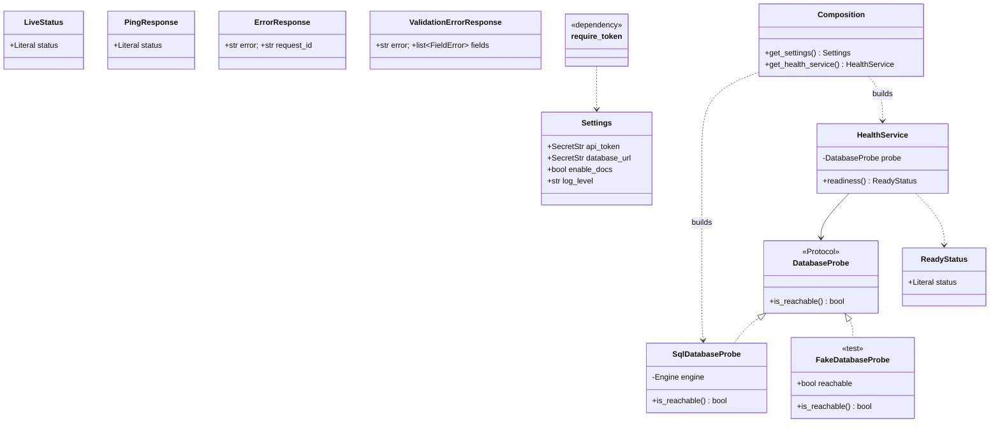
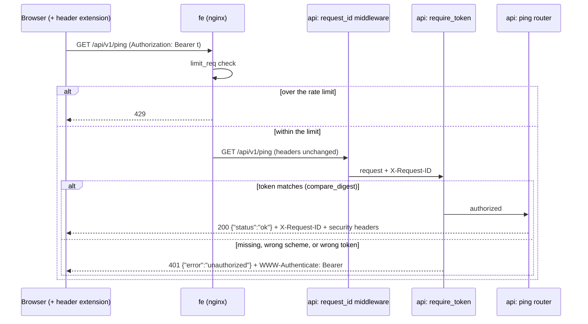
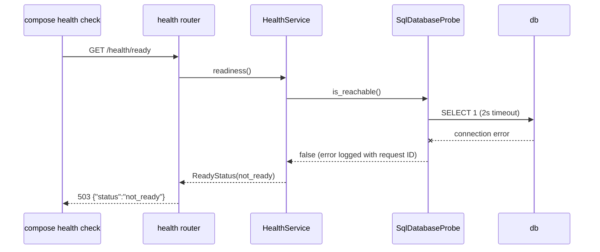

# Design

## Context

Greenfield repository: only docs, OpenSpec config, `CLAUDE.md` and `README.md` exist. The stack, layering, SOLID rules, testing approach and security baseline are fixed in `CLAUDE.md`; motivation and scope are in `proposal.md`; behavior is in `specs/`. This design covers how the five containers, the `api` skeleton and the tooling fit together.

## Goals / Non-Goals

**Goals:**
- A layout that later changes extend without restructuring: the engine adds services and ports; the actions change adds write ports.
- Only Docker is needed to run, test and lint; a reviewer does not install Python or uv.
- Every foundation behavior that can be unit-tested is unit-tested; the rest is covered by a scripted smoke check.

**Non-Goals:**
- Tool contracts in `mock-tools`, application tables, TLS, multiple users or roles.

## Decisions

### D1. Repository layout

```
docker-compose.yml   Makefile   .env.example   scripts/smoke.sh
api/
  Dockerfile         (targets: runtime, dev)
  pyproject.toml     uv.lock   alembic.ini   (import-linter + ruff + pytest config in pyproject)
  migrations/        env.py, versions/0001_baseline.py
  src/companion/
    main.py          create_app() factory
    config.py        Settings
    composition.py   composition root: builds concrete adapters, exposes FastAPI dependencies
    presentation/    routers/ (health, ping), auth.py, errors.py, request_id.py
    services/        health.py
    ports/           Protocols consumed by services (database.py)
    repositories/    sql/ (engine.py, tables.py, probe.py)
    schemas/         health.py, errors.py, ping.py
  tests/unit/
mock-tools/          Dockerfile, pyproject.toml, src/mock_tools/main.py (health only)
fe/                  nginx.conf, public/ (index.html, app.js, vendor/alpine-csp.min.js)
```

Ports live in their own package, not in `services/` or `repositories/`. Both layers depend on them, and neither depends on the other, which keeps the import-linter contracts simple (D7).
*Alternative discarded:* Protocols inside `services/` (adapters would then import the services package, blurring the contract) or inside `repositories/` (services would import the data-access package).

### D2. Readiness goes through a port, even though it is trivial

`HealthService` depends on a `DatabaseProbe` Protocol; `SqlDatabaseProbe` implements it with `SELECT 1` and a 2-second timeout. The router calls the service, never the engine.
*Why:* it sets the pattern every later feature follows (router → service → port ← adapter), and lets the readiness spec be unit-tested with a fake probe.
*Alternative discarded:* the router running `SELECT 1` directly. Less code, but it would be the first violation of the layer rule in the codebase.

### D3. Configuration with pydantic-settings

`Settings` reads `API_TOKEN` (`SecretStr`, minimum 32 characters), `DATABASE_URL` (`SecretStr`), `ENABLE_DOCS` (bool, default `false`) and `LOG_LEVEL`. `SecretStr` masks the values in `repr` and logs. Invalid settings raise at startup, so the API fails closed.
*Alternative discarded:* plain `os.environ` reads, which give no validation, no masking and scattered access.

### D4. Authentication as a presentation dependency

`require_token` is a FastAPI dependency attached to the `/api/v1` router, so a new route under it is protected by default. It uses `HTTPBearer(auto_error=False)` so the scheme appears in OpenAPI (spec `api-docs`) while the 401 stays under our control. It parses `Authorization: Bearer <token>`, compares with `hmac.compare_digest`, and raises one `Unauthorized` error that `errors.py` turns into the uniform 401 (spec `api-authentication`). Health routes are mounted outside `/api`.
*Why presentation:* parsing a header and choosing a status code is HTTP work, not business logic.
*Alternative discarded:* global middleware with an allowlist of public paths, where forgetting to update the allowlist would expose a route.

### D5. Error contract and request IDs

A pure ASGI middleware sets the request ID (reused when it matches `^[A-Za-z0-9-]{1,64}$`, otherwise `uuid4`). It stores the ID in a `contextvars` variable that a logging filter adds to every log line. Exception handlers in `errors.py` map `Unauthorized` → 401, unknown routes → 404, `RequestValidationError` → 422 (field locations and messages only, no `input` values), and any other exception → 500 with the request ID (spec `api-errors`). The 500 handler logs the exception with its traceback server-side.
*Alternative discarded:* FastAPI's default handlers, which echo the submitted input in 422 responses and return a plain-text 500.

### D6. Running everything through Docker

| Target | Runs |
|---|---|
| `make env` | creates `.env` from `.env.example` and fills `API_TOKEN` and `POSTGRES_PASSWORD` with random values; refuses to overwrite an existing `.env` |
| `make up` / `down` / `logs` | `docker compose up -d --build` / `down` / `logs -f` |
| `make migrate` | `docker compose run --rm migrate` |
| `make migration name=...` | `alembic revision --autogenerate -m "$(name)"` in the `tools` service |
| `make test ARGS=...` | `pytest $(ARGS)` in the `tools` service |
| `make lint` / `format` | `ruff check` + `lint-imports` / `ruff format` |
| `make check` | `lint` + `test` |
| `make smoke` | `scripts/smoke.sh` against the running stack |

`tools` is a compose service under the `dev` profile, built from the `dev` Dockerfile target (with dev dependencies), with the source mounted, so the TDD loop does not need a rebuild.
*Alternative discarded:* uv on the host. The test loop would be faster, but the reviewer would need a Python toolchain.

### D7. import-linter contracts (in `api/pyproject.toml`)

1. `companion.services` must not import `fastapi`, `starlette`, `sqlalchemy`, `httpx`, `companion.presentation` or `companion.repositories`.
2. `companion.ports` and `companion.schemas` must not import `companion.services`, `companion.repositories` or `companion.presentation`.
3. `companion.repositories` must not import `companion.presentation` or `companion.services`.
4. `companion.presentation` must not import `companion.repositories` (it reaches adapters only through `composition`).

Rule 4 is what makes `composition.py` the single composition root. The read/write port split contract is added by the actions change, when write ports first exist.

### D8. Compose topology

```
 browser --:8080--> fe (nginx) --/api/*--> api :8000 --> db (postgres)
                                            ^
               migrate (one-shot) ----------'-- runs before api starts
               mock-tools :8001 (health only in this change)
```

- `db`: `postgres:16-alpine`, `pg_isready` health check, a named volume, no published port.
- `migrate`: the `api` runtime image running `alembic upgrade head`; depends on `db` being healthy.
- `api`: depends on `migrate` completing successfully; health check on `/health/ready`, using Python's `urllib` because the slim image has no curl; published on `127.0.0.1:8000` only.
- `fe`: `nginx:1.27-alpine`; depends on `api` being healthy; published on `127.0.0.1:8080`.
- `mock-tools`: health check only; not published.
- All Python images run as a non-root user, and image versions are pinned.

### D9. nginx configuration

A static config file is enough, because nginx holds no secrets and needs no environment templating.
- `location /api/ { proxy_pass http://api:8000; }`, with no URI part, so the path is forwarded unchanged and the `Authorization` header passes through untouched.
- `limit_req_zone $binary_remote_addr zone=api:10m rate=10r/s;` plus `limit_req zone=api burst=20 nodelay; limit_req_status 429;` on `/api/`.
- `client_max_body_size 1m`, `server_tokens off`, and the security headers from spec `passenger-web` with `always`.
- No `/health` location, so health stays internal.

### D10. Alpine.js CSP build

The page uses Alpine's CSP build (`@alpinejs/csp`), kept in `fe/public/vendor/`, so the policy can stay `script-src 'self'` with no `'unsafe-eval'`. The standard Alpine build needs `'unsafe-eval'`. `app.js` registers the component with `Alpine.data(...)`, and no inline scripts or handlers are used.
*Alternative discarded:* the standard build from a CDN, which would weaken the CSP and add a third-party script origin.

### D11. Alembic

`env.py` reads the database URL from `Settings`, uses `target_metadata` from `repositories/sql/tables.py` (an empty `MetaData` in this change), and sets `render_as_batch=True`. `0001_baseline` is empty; it is an **expand** phase (additive, nothing to migrate or contract). Every revision must include a working `downgrade()`.

### D12. Pydantic schemas and HTTP contract

| Endpoint | Auth | Responses |
|---|---|---|
| `GET /health/live` | none | 200 `LiveStatus{status: "ok"}` |
| `GET /health/ready` | none | 200 `ReadyStatus{status: "ready"}`, 503 `ReadyStatus{status: "not_ready"}` |
| `GET /api/v1/ping` | Bearer | 200 `PingResponse{status: "ok"}`, 401 `ErrorResponse` |
| any unknown path | — | 404 `ErrorResponse{error: "not_found"}` |
| any validation failure | — | 422 `ValidationErrorResponse{error, fields: [FieldError{loc, msg}]}` |
| any unhandled exception | — | 500 `ErrorResponse{error: "internal_error", request_id}` |

Every route declares `response_model`, so responses contain only declared fields.

**API documentation (spec `api-docs`).** `create_app()` passes `docs_url="/docs"` and `openapi_url="/openapi.json"` only when `ENABLE_DOCS=true`, otherwise `None`; `redoc_url` is always `None`. `.env.example` sets `ENABLE_DOCS=true` for the local demo. Shared response declarations live in `presentation/responses.py` (`PROTECTED_RESPONSES` = 401/404/422/500 and `PUBLIC_RESPONSES` = 404/422/500, each mapped to its error schema) and are attached through the routers' `responses=` argument, so new routes inherit them. Docs are read on `127.0.0.1:8000/docs`, not through nginx, because Swagger UI loads its assets from a CDN that the `fe` CSP (`default-src 'self'`) would block. Keeping it off the proxied origin avoids weakening that policy.
*Alternatives discarded:* serving docs behind the token (Swagger UI cannot fetch `/openapi.json` before the user authorizes, which hurts the demo); self-hosting the Swagger UI assets to serve docs through nginx (more vendored files for little value in a local demo).

### D13. Write tool calls, idempotency and retries

None in this change. The readiness probe has a 2-second timeout and no retries.

### D14. Secrets

`API_TOKEN` and `POSTGRES_PASSWORD` exist only in `.env` (gitignored). Compose builds `DATABASE_URL` from them through variable interpolation. `.env.example` contains only placeholders. The test suite builds `Settings` from literal test-only values, never from `.env`.

## Diagrams

### Class diagram



### Sequence: authenticated call through the proxy, with the 401 path



### Sequence: readiness with the database down



## SOLID notes

- **SRP:** auth, request IDs, error mapping, health logic and DB probing are separate modules.
- **OCP:** new protected routes join the `/api/v1` router and inherit auth without editing it.
- **LSP:** `FakeDatabaseProbe` and `SqlDatabaseProbe` are interchangeable behind `DatabaseProbe`.
- **ISP:** `DatabaseProbe` exposes one method; services get nothing else.
- **DIP:** `HealthService` depends on the Protocol; only `composition.py` builds concrete classes.
- **Deliberate deviation:** none.

## OWASP coverage

| Risk | Control in this change |
|---|---|
| API1 Broken Object Level Authorization | No object endpoints yet. The engine change must authorize access per booking. |
| API2 Broken Authentication | Bearer token, constant-time comparison, minimum length, fail-closed startup, uniform 401 |
| API3 Broken Object Property Level Authorization | `response_model` on every route, so only declared fields are returned |
| API4 Unrestricted Resource Consumption | nginx rate limit (10 r/s, burst 20); 1 MB body limit; 2 s probe timeout |
| API5 Broken Function Level Authorization | Single role in this change; noted for the actions change (human-approval flows) |
| API7 Server Side Request Forgery | No caller-supplied URLs are fetched |
| API8 Security Misconfiguration | Security headers, `server_tokens off`, docs off by default, non-root containers, ports bound to 127.0.0.1, generic errors |
| API9 Improper Inventory Management | Versioned `/api/v1` prefix; OpenAPI generated from code and checked by a contract test, so the inventory cannot drift from the routes; docs off by default and never proxied |
| API6, API10 | Not applicable yet (no business flows; no third-party API consumption) |
| OWASP Top 10 A02 Cryptographic Failures | No TLS on localhost: accepted for a local demo, recorded as a limitation |
| OWASP Top 10 A06 Vulnerable Components | Pinned image tags and `uv.lock` |
| OWASP Top 10 A09 Logging Failures | Request ID on every log line; tokens and `Authorization` values are never logged |

## Test strategy

Unit tests (`api/tests/unit/`, pytest, written before the code):
- **Auth:** `TestClient` over `create_app()` with a test `Settings` override. Covers valid, missing, wrong scheme and wrong token; identical 401s; health is public; the token is absent from captured logs (`caplog`).
- **Settings:** a missing or too-short token raises at construction; `repr` does not reveal the token.
- **Errors:** a test-only router mounted on the app raises `RuntimeError`, exposes an integer query parameter, and covers unknown paths. Checks the 500, 404 and 422 bodies, that values are not echoed, and the request ID rules.
- **Health:** `HealthService` with `FakeDatabaseProbe` (reachable and unreachable); the router via dependency override; `SqlDatabaseProbe` against a SQLite file in `tmp_path`.
- **Migrations:** `alembic upgrade head` then `downgrade base` against a SQLite file in `tmp_path`. A file is used instead of `:memory:` because Alembic opens its own connection.
- **API docs:** `create_app()` with docs enabled and disabled; a contract test walks `app.openapi()` and asserts every operation lists its required status codes with schemas, `/api/` operations require the Bearer scheme and `/health/` ones have none, and the document contains neither the token nor the database URL.
- **Layering:** `lint-imports` runs in `make check`.

Not unit-testable, covered by `make smoke` (curl against the running stack):
- The page returns 200 with the security headers.
- `/api/v1/ping` returns 401 without a token and 200 with one.
- `/health/ready` is 404 through nginx.
- A 50-request burst produces at least one 429.

The page's three displayed states are checked manually in the browser.

## Risks / Trade-offs

- [Postgres-specific behavior untested by unit tests] → portable types only; `make smoke` runs against Postgres.
- [Running pytest inside Docker is slower than on the host] → source is mounted and the image is not rebuilt per run. uv on the host still works for anyone who has it.
- [A single shared token gives no passenger identity] → explicit next step; documented in the README decision record.
- [Plain HTTP on localhost] → accepted for a local demo; TLS terminates at nginx in any real deployment.
- [The 3-hour budget] → mock-tools stays a skeleton and the page shows only the connection state.

## Migration Plan

Greenfield, so there is nothing to migrate. Roll back with `make down` (add `-v` to drop the database volume) or `alembic downgrade base`.
