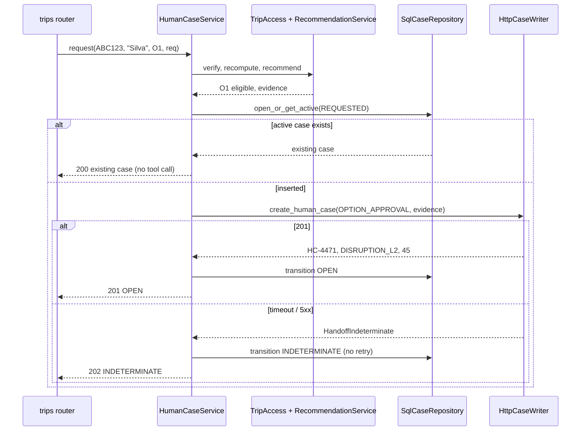

# Design

## Context

`add-trip-status` (archived) delivers the lookup, a pure deterministic assessment, the `trip_assessments` audit, read-tool clients with bounded responses, and a page with two disabled buttons. See proposal.md for motivation and the specs `recommendation`, `human-handoff`, `mock-tools`, `passenger-web` for behavior. This change adds the first write port, which is also when the foundation's postponed read/write layer contract arrives.

## Goals / Non-Goals

**Goals:** policy-backed proposals that cannot execute anything; a single, deduplicated, auditable way to reach a person; patterns that let policies, filters, and case states grow without touching the engine.

**Non-Goals:** `create_rebooking_request`, `notify_passenger`, automatic approval, back office, signed lookup tokens, collecting `compensation_requested`, airport countries (`international`). All are described in `docs/future-work.md` (D14).

## Module layout and layers

```
api/src/companion/
  schemas/tools.py          + PolicyRules, PolicyRule, EligibleOptions, EligibleOption (upstream DTOs)
  schemas/recommendation.py Entitlement, RuleEvaluation, Exclusion, Recommendation, HTTP request/response
  schemas/handoff.py        CaseReason, CaseStatus, Evidence, HumanCase, HTTP request/response
  ports/tools.py            + PolicyReader, OptionsReader (read)
  ports/handoff.py          HumanCaseWriter (write tool) + HandoffIndeterminate, HandoffRejected
  ports/cases.py            CaseRepository + ActiveCaseExists, CasesUnavailable
  ports/audit.py            AssessmentLog.record now returns the record id
  services/trip_access.py   TripAccess: verify surname, recompute + record assessment (extracted)
  services/trip_status.py   uses TripAccess (behavior unchanged)
  services/policy/          conditions.py (Interpreter), facts.py (fact registry), entitlements.py   pure
  services/options/         specifications.py (Specification), selection.py (filter + rank)        pure
  services/recommendation.py RecommendationService (read ports only)
  services/handoff.py       HumanCaseService (the only holder of HumanCaseWriter)
  schemas/case_states.py    transition table (state machine), next to CaseStatus so repositories may use it
  repositories/tools/http.py  HttpToolsClient + policy/options reads; HttpCaseWriter (separate class)
  repositories/sql/cases.py   SqlCaseRepository
  presentation/routers/trips.py  + /recommendation, /human-case
```

New import-linter contracts: (1) **read-only services never see the write port**: `companion.services.trip_status`, `companion.services.trip_access`, `companion.services.recommendation`, `companion.services.assessment`, `companion.services.policy`, and `companion.services.options` must not import `companion.ports.handoff`. (2) `companion.services.policy` and `companion.services.options` are pure: they must not import `companion.ports`.

## Decisions

### D1. One verified path for every trip call (refactor)
`TripAccess.verified_assessment(booking_id, last_name, request_id)` holds what the lookup already did: fetch context, check the surname (same 404), strip PII into `TripFacts`, read events and rules, assess, record. It returns `VerifiedTrip{context_meta, facts, assessment, assessment_id, airports}`. `TripStatusService`, `RecommendationService`, and `HumanCaseService` all call it, so re-verification and server-side recomputation cannot be skipped by a new endpoint.
*Alternatives discarded:* each service repeating the steps (drift, one forgets the surname check); passing the lookup result from the client (trusts the client).

### D2. Policy conditions with the Interpreter pattern (ADR row)
`conditions.py` tokenizes `<fact> <op> <literal> (AND <fact> <op> <literal>)*` with a strict regex grammar, builds an AST of `Comparison` and `And` nodes, and evaluates it to `Tri.{TRUE, FALSE, UNKNOWN}` (Kleene logic: `FALSE AND x = FALSE`, `TRUE AND UNKNOWN = UNKNOWN`). Literals are integers or `true`/`false`. A parse error or an unknown fact gives `UNKNOWN`, and the rule is listed under `unevaluated_rules`. There is no `eval`, no `ast.literal_eval` over the condition, and no attribute access.
*Alternatives discarded:* `eval` (code execution: A03 Injection); hard-coding R1–R5 (breaks with the next policy version); a general expression library (more surface than five facts need).

### D3. Facts through a registry
`facts.py` maps a fact name to a provider `(VerifiedTrip) -> int | bool | None` (`None` means unknown). Providers: `delay_minutes` (largest accepted delay), `missed_connection`, `group_includes_minor` (a passenger of type `CHILD` or `INFANT`), `compensation_requested` (always false: not collected), `international` (unknown: airports have no country yet). A new fact is a new provider (OCP).

### D4. Option filters with the Specification pattern
Each filter is a class with `code` and `excludes(option, ctx) -> bool`: `NotEntitled`, `InsufficientSeats` (seats < passengers: the party is never split), `FeeConflictsEntitlement`, `WrongRoute`, `DepartsTooEarly`, `PolicySuperseded`, `LowConfidence`. `ctx` holds the entitlements, the party size, the policy, the anchor airport, the earliest departure, and the airports. The **anchor** is the connection airport of the first `MISSED` connection (earliest departure = that segment's estimated arrival + MCT from the rule set); without a missed connection, the origin of the first delayed segment (no earliest bound). Route and time checks apply to `REBOOK` only. `selection.py` runs every specification (collecting all codes, not just the first), keeps the options with none, and ranks them by confidence, then local departure resolved with the airport's IANA zone.
*Alternative discarded:* one `if` chain (each new rule edits it; only the first failing reason surfaces).

### D5. Policy scenario, version, and TTL
The scenario follows the reasons (`CANCELLATION` → `CANCELLATION`, else `DELAY`). `PolicyReader` raises `PolicyNotFound` on 404 and `ToolUnavailable` on failure; both become `NEEDS_AGENT/POLICY_UNAVAILABLE`. A policy whose `effective_from` is after the assessment date is treated as unavailable. Options expire at `_meta.retrieved_at + ttl_seconds`. If expired when evaluated, they are fetched once more; still expired → `NEEDS_AGENT/OPTIONS_EXPIRED`. The expiry travels into the case evidence so the agent knows the snapshot is stale and re-fetches before acting.

### D6. Recommendation result
`status` is `NOT_APPLICABLE` (not disruptive), `PROPOSED`, or `NEEDS_AGENT` (with a `reason`). `approval` is always `HUMAN_REQUIRED` in this version (decision: the human case is the approval mechanism). The explanation is templated and cites the rule ids and policy version, ready for a future `notify_passenger` that requires `policy_ref`. Excluded options are logged with their codes, never returned.

### D7. Human case service
`HumanCaseService.request(booking_id, last_name, option_id, request_id)`:
1. `TripAccess` (404 on mismatch, nothing recorded).
2. Reason: `UNVERIFIED` → `STATUS_VERIFICATION` (an `option_id` gives 409 `option_not_eligible`); `DISRUPTIVE` → recommendation, then `OPTION_APPROVAL` if `option_id` is eligible, 409 if not, `ASSISTANCE_REQUIRED` without it; otherwise 409 `nothing_to_escalate`.
3. Evidence (spec `human-handoff`): ids and codes only; party as counts by type; no names.
4. `CaseRepository.open_or_get_active(...)` inserts `REQUESTED` or returns the active case (200, no tool call). Insert failure → 503 `handoff_unavailable`, tool not called.
5. `HumanCaseWriter.create(reason, evidence)` → transition to `OPEN`, `INDETERMINATE`, or `FAILED` (D9).

### D8. `human_cases` table and state machine
Revision `0005_human_cases` (**expand**). Columns: `id` (UUID), `booking_id`, `active_booking_id` (nullable, **unique**), `reason`, `status`, `option_id`, `assessment_id`, `evidence` (JSON), `case_id`, `queue`, `sla_minutes`, `request_id`, `created_at`, `updated_at`. One active case per booking is enforced by the unique `active_booking_id`: it is set to the booking code for `REQUESTED`/`OPEN`/`INDETERMINATE` and cleared on `FAILED`. A concurrent second insert hits the constraint, and the repository returns the existing active case. This works on SQLite and PostgreSQL because both allow multiple NULLs. `schemas/case_states.py` (a pure rule over `CaseStatus`, placed in `schemas` so the repository can enforce it without importing `services`) holds the allowed transitions `{REQUESTED: {OPEN, INDETERMINATE, FAILED}}`; `transition()` rejects anything else, and the repository updates only through it. Rows are never deleted.
*Alternatives discarded:* check-then-insert without a constraint (race on double click); a partial unique index (not portable); relying on the tool for idempotency (its contract has no key).

### D9. Write tool call: `create_human_case`
`HttpCaseWriter` is a separate class from the read client (ISP), sharing the bounded-response plumbing. `POST /tools/create_human_case {reason, evidence}`, timeout 1 s connect / 3 s read, **no retries**. 201 with a valid body → `OPEN`; timeout, connection error, or 5xx → `INDETERMINATE` (outcome unknown: never retried, the passenger is told to call if nothing happens within 45 min, ops reconciles); a 201 whose body cannot be read → `INDETERMINATE` too (the case exists upstream but we lack its id, so `FAILED` would invite a duplicate; found during apply); any other status → `FAILED` (definitely not created; a new request may try again). The evidence is never logged.

### D10. Mock tools
`get_policy_rules` (`DELAY` = brief, else 404), `get_eligible_options` (keyed by `booking_id`: brief O1–O3 for `ABC123`/`CASERR`, the same shape shifted for `NITE01`, two REBOOK options for `CANC01`, `[]` otherwise), `create_human_case` (201 with a counter-based `HC-<n>`; 503 `UPSTREAM_TIMEOUT` when `evidence.booking_id` is `CASERR`). `CASERR` mirrors `ABC123` with ids `CASERR-S1`/`CASERR-S2` and event ids prefixed `E-CASERR-`. Option dates and `retrieved_at` are time-shifted like the other fixtures.

### D11. HTTP contract

| Endpoint | Auth | Responses |
|---|---|---|
| `POST /api/v1/trips/recommendation` | Bearer + surname | 200 `RecommendationResponse`; 401; 404; 422; 503 `trip_context_unavailable`; 500 |
| `POST /api/v1/trips/human-case` | Bearer + surname | 201/200 `HumanCaseResponse` (`OPEN`); 202 (`INDETERMINATE`); 401; 404; 409 `option_not_eligible`/`nothing_to_escalate`; 422; 503 `trip_context_unavailable`/`handoff_unavailable`; 500 |

- `RecommendationRequest{booking_id, last_name}` and `HumanCaseRequest{booking_id, last_name, option_id?: ^[A-Za-z0-9-]{1,16}$}`, both `extra="forbid"`.
- `RecommendationResponse{status, reason?, policy_version?, entitlements[{code, rule_id, requires_human_approval}], unevaluated_rules[rule_id], options[{option_id, type, flight_number?, origin?, destination?, departure?, fare_difference?, currency?, confidence}], options_expire_at?, approval, explanation, next_step}`.
- `HumanCaseResponse{status, reason, case_id?, queue?, sla_minutes?, message}`.

### D12. Frontend
New view states in the `tripLookup` component: `recommendation` and `case`. The booking code and surname of the last lookup stay in component properties (never persisted, reset on a new lookup) and are resent in the JSON body. "Request this option" passes the option id through a `data-option` attribute read from the click event (the CSP build has no call-with-arguments). Buttons are disabled while a call is in flight. Times are shown as local `HH:MM` plus airport code, like the lookup.

### D13. Docs and dev containers
README keeps: the problem, how to run, the demo codes (adding `CASERR`), the end-to-end flow (one Mermaid diagram), and the automation matrix (demo vs future). `docs/decisions.md` takes the full ADR table (rows 1–25 plus new rows 26–31: D1, D2, D4, D7/D8, D9, automation). `docs/future-work.md` holds D14. The `docs/` files are tracked (`.gitignore` excludes only `docs/internal/*`). Dev containers are renamed `tools` → `api-dev` and `mock-tools-tools` → `mock-tools-dev` in compose, the Makefile, and CLAUDE.md, because "tools" also means the brief's airline tools.

### D14. Future work (documented, not built)
- **From approved case to rebooking:**

```
OPEN --agent approves--> APPROVED --refetch options (TTL), still eligible?--+
                                                                            v
     create_rebooking_request(option, idempotency_key = hash(case_id, option_id))
        201 PENDING_CONFIRMATION --> REBOOK_REQUESTED --> notify_passenger(policy_ref)
        409 DUPLICATE_REQUEST    --> adopt request_id  --> REBOOK_REQUESTED
        503 UPSTREAM_TIMEOUT     --> REBOOK_INDETERMINATE (never retried; reconcile)
     option gone or ineligible  --> back to the agent (NEEDS_NEW_OPTION)
OPEN --agent rejects--> REJECTED --> notify_passenger(policy_ref)
```

  The approval arrives through an agent-only endpoint with its own role (OWASP API5), and the action is recorded before it is attempted.
- **Automatic approval:** when every applying rule has `requires_human_approval: false`, the top option is `HIGH` confidence with no fare difference and enough seats, and the assessment is fresh. R5 is assumed to gate only its own entitlement (PM to confirm).
- **Notifications:** templated, verified facts only, always with `policy_ref`; a 422 is our bug, not something to strip.
- **Back office:** roles (agent, ops, PM, admin); case queue; policy, relevance rule, and airport data authored as new versions with four-eyes approval; audit of admin actions.
- **Signed lookup token** replacing surname resends; real passenger authentication; per-booking lockout.
- LLM explanation composer with verifier; a cancellation policy (Policy/Legal); airport countries for `international`; `trip_assessments` retention; reconciliation of `INDETERMINATE` cases.

### D15. Assessment record id
`AssessmentLog.record` returns the new record's id so evidence can reference it. A failed record still does not block a lookup or a recommendation (`assessment_id` is then `null`); the hand-off refuses to create a case without one (503 `handoff_unavailable`), because an action must be traceable to its decision.

## Diagrams

### Sequence: recommendation for ABC123, with the options outage

```mermaid
sequenceDiagram
    participant R as trips router
    participant S as RecommendationService
    participant A as TripAccess
    participant T as HttpToolsClient
    participant P as policy (Interpreter)
    participant O as options (Specifications)
    R->>S: recommend(ABC123, "Silva", req)
    S->>A: verified_assessment(...)
    A-->>S: VerifiedTrip (DISRUPTIVE, assessment_id)
    S->>T: get_policy_rules("DELAY")
    T-->>S: POL-DELAY-2026-03
    S->>P: evaluate(rules, facts)
    P-->>S: REBOOK_NO_FEE (R3), PRIORITY_HANDLING (R5)
    S->>T: get_eligible_options(context)
    alt options tool fails
        T-->>S: ToolUnavailable
        S-->>R: NEEDS_AGENT / OPTIONS_UNAVAILABLE
    else ok (expired? refetch once)
        T-->>S: O1, O2, O3 (ttl 120)
        S->>O: select(options, ctx)
        O-->>S: eligible [O1]; excluded O2, O3 (logged)
        S-->>R: PROPOSED, approval HUMAN_REQUIRED
    end
```

### Sequence: human case, with the duplicate and indeterminate paths



### Class diagram

```mermaid
classDiagram
    class PolicyReader { <<Protocol>> +get_policy_rules(scenario) PolicyRules }
    class OptionsReader { <<Protocol>> +get_eligible_options(context) EligibleOptions }
    class HumanCaseWriter { <<Protocol>> +create(reason, evidence) CreatedCase }
    class CaseRepository { <<Protocol>> +open_or_get_active(case) HumanCase; +transition(id, status, data) }
    class HttpToolsClient
    class HttpCaseWriter
    class SqlCaseRepository
    PolicyReader <|.. HttpToolsClient
    OptionsReader <|.. HttpToolsClient
    HumanCaseWriter <|.. HttpCaseWriter
    CaseRepository <|.. SqlCaseRepository

    class TripAccess { +verified_assessment(booking, surname, req) VerifiedTrip }
    class TripStatusService
    class RecommendationService { +recommend(booking, surname, req) Recommendation }
    class HumanCaseService { +request(booking, surname, option_id, req) HumanCase }
    TripStatusService --> TripAccess
    RecommendationService --> TripAccess
    RecommendationService --> PolicyReader
    RecommendationService --> OptionsReader
    HumanCaseService --> RecommendationService
    HumanCaseService --> CaseRepository
    HumanCaseService --> HumanCaseWriter

    class Condition { <<interface>> +evaluate(facts) Tri }
    class Comparison
    class And
    Condition <|.. Comparison
    Condition <|.. And
    class FactRegistry { +value(name, trip) int|bool|None }
    class OptionSpecification { <<Protocol>> +code; +excludes(option, ctx) bool }
    class InsufficientSeats
    class FeeConflictsEntitlement
    class NotEntitled
    OptionSpecification <|.. InsufficientSeats
    OptionSpecification <|.. FeeConflictsEntitlement
    OptionSpecification <|.. NotEntitled
    class CaseStatus { <<enum>> REQUESTED OPEN INDETERMINATE FAILED }
```



## SOLID notes

- **SRP:** verification (`TripAccess`), conditions, facts, filters, ranking, orchestration, persistence, and the write call are separate.
- **OCP:** new facts, filters, and case states are new entries, not edits to engines.
- **LSP:** fakes for every new port are interchangeable with the adapters.
- **ISP:** `HumanCaseWriter` is its own Protocol and class; read services cannot import it (contract).
- **DIP:** wiring stays in `composition.py`.
- **Deliberate deviation:** `human_cases` rows are updated (status transitions), unlike the append-only `trip_assessments`; updates go only through the transition table.

## OWASP coverage

| Risk | Control |
|---|---|
| API1 BOLA | Surname re-verified on every call (D1); case lookup by booking only after verification |
| API3 Property Level | Response models whitelist fields; excluded options and evidence never returned |
| API4 Resource Consumption | Bounded tool responses; TTL refetch at most once; nginx rate limit |
| API5 Function Level | No agent/admin endpoints in this change; future approval endpoint needs its own role (D14) |
| API6 Sensitive Business Flows | One active case per booking (unique constraint); intent required (explicit option) |
| API8 Misconfiguration | Generic errors (`handoff_unavailable`), upstream bodies never passed through |
| API10 Unsafe Consumption | Policies and options validated; conditions interpreted, never executed |
| A03 Injection | Interpreter with a strict grammar; SQL via bound parameters |
| A04 Insecure Design | Every action needs a human; indeterminate outcomes never retried; intent recorded first |
| A09 Logging | No body, surname, names, or evidence content in logs |

## Test strategy

Unit tests, written first. `test_conditions.py` (grammar, Kleene table, unknown facts, injection strings), `test_facts.py`, `test_option_specifications.py` (each spec plus the O1–O3 matrix), `test_option_selection.py` (all codes, ranking), `test_recommendation_service.py` (fakes: not applicable, cancellation without policy, TTL refetch, options down), `test_case_states.py`, `test_case_repository.py` (SQLite: active uniqueness under a second insert, transitions), `test_handoff_service.py` (reasons, evidence without PII, intent-first, 201/202/503 mapping, no retry, duplicate), `test_tools_client.py` additions (policy 404, options, case writer mapping), router tests for both endpoints, `test_migrations.py` (0005 up/down), and the existing `TripStatusService` tests unchanged after the `TripAccess` extraction. mock-tools: the three tools and `CASERR`. Smoke: ABC123 recommendation → `PROPOSED` with O1; a case → 201 then 200 on repeat; `CASERR` → 202. Browser: the four new views.

## Risks / Trade-offs

- [Every disruption needs an agent, which conflicts with fewer contacts] → explicit v1 choice; automatic approval path in D14.
- [`create_human_case` has no idempotency key] → local unique active case; `INDETERMINATE` never retried.
- [Clock skew between our clock and `retrieved_at`] → mock aligns them; real integration should compare against our receipt time (noted in future work).
- [Unknown `international`] → only R2 depends on it, and its first clause is FALSE for every scenario; airport countries are future work.
- [The `TripAccess` refactor could change lookup behavior] → existing trip-status tests must pass unchanged before new code lands.
- [Larger than the time budget] → cut ranking and the `NITE01` options first.

## Migration Plan

`0005_human_cases` (expand) runs with `make up`. Rollback: `alembic downgrade 0004` drops the table. The previous code ignores it.
