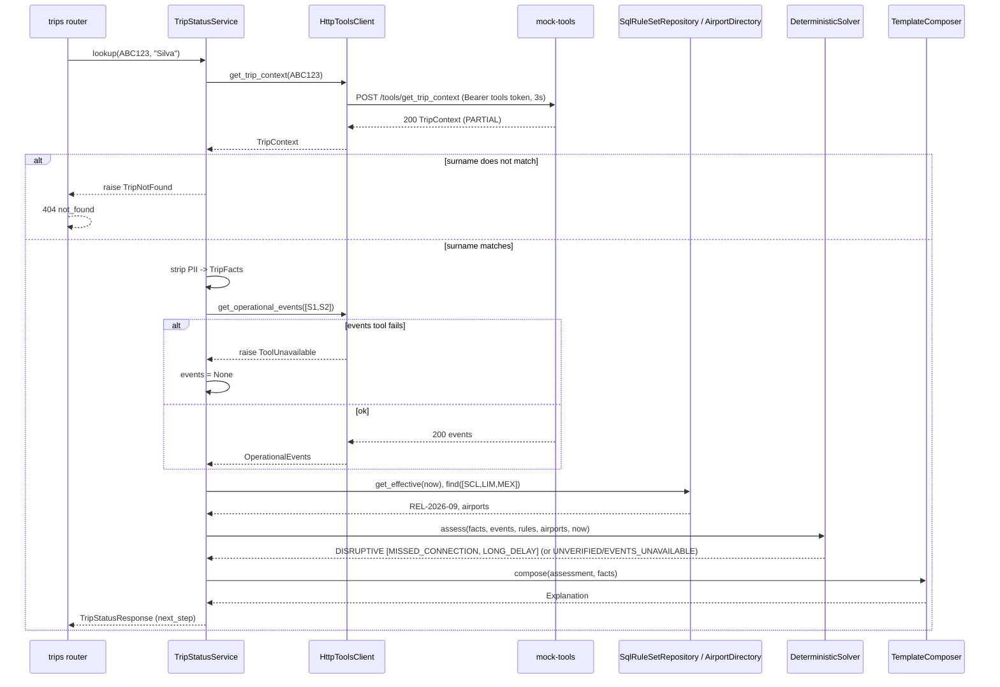
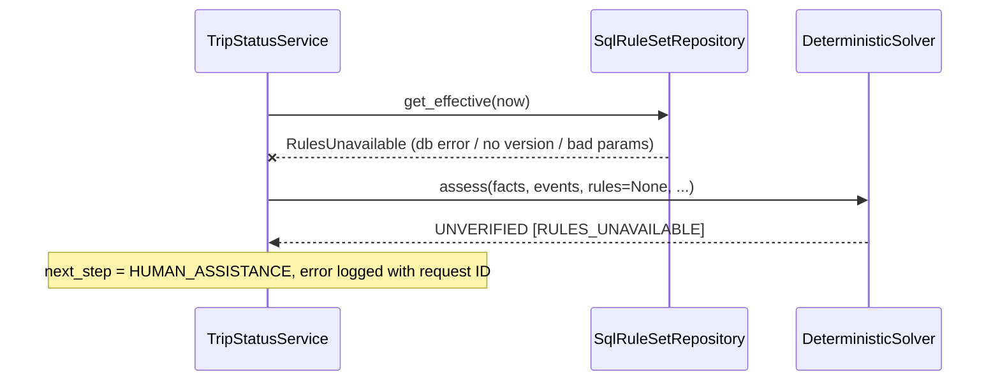

# Design

## Context

The foundation (archived `2026-11-04-add-project-foundation`) provides the four-layer `api` with a composition root, Bearer auth on `/api/v1`, the error contract, an empty Alembic baseline, a `mock-tools` skeleton with health only, and an Alpine.js page that pings the API. See proposal.md for motivation and specs for behavior: `trip-status`, `disruption-assessment`, `mock-tools`, `passenger-web`.

## Goals / Non-Goals

**Goals:** one lookup call that returns a verified trip status; relevance rules that change without a deploy and leave an audit trail; seams where an AI explanation could be added later without touching the decision logic.

**Non-Goals:** policies and entitlements, options, write tools, an endpoint for editing rules, runtime AI, retries on read tools, caching.

## Module layout and layers

```
api/src/companion/
  schemas/tools.py          upstream contract DTOs (TripContext, OperationalEvents, ...)   schemas
  schemas/assessment.py     domain DTOs and enums (TripFacts, RelevanceRuleSet, Assessment) schemas
  schemas/trip_status.py    HTTP DTOs (TripLookupRequest, TripStatusResponse, ...)          schemas
  ports/tools.py            TripContextReader, OperationalEventsReader + errors             ports
  ports/rules.py            RuleSetRepository, AirportDirectory + RulesUnavailable           ports
  ports/clock.py            Clock                                                            ports
  services/trip_status.py   TripStatusService (orchestration, surname check, PII strip)     services
  services/surname.py       surname_matches (pure)                                           services
  services/assessment/      reconciliation.py, timeline.py, criteria.py, solver.py,         services
                            explanation.py  (pure: no ports, no I/O)
  repositories/tools/http.py HttpToolsClient (httpx) implements both reader ports          repositories
  repositories/sql/tables.py + rules.py  SqlRuleSetRepository, SqlAirportDirectory         repositories
  repositories/clock.py     SystemClock                                                      repositories
  presentation/routers/trips.py  POST /api/v1/trips/lookup                                  presentation
  composition.py            builds and wires everything (single composition root)
mock-tools/src/mock_tools/  main.py, auth.py, settings.py, fixtures.py, timeshift.py
```

Dependencies point inward: presentation → composition → services → ports/schemas ← repositories. A new import-linter contract makes the assessment package pure: `companion.services.assessment` must not import `companion.ports`, so it only ever receives data. Read and write ports stay separate (ISP). This change adds only read ports, so the read/write contract from the foundation's D7 still waits for the actions change.

## Decisions

### D1. Definition of a disruptive result (README ADR 17)
Four tiers with precedence DISRUPTIVE > UNVERIFIED > INFORMATIONAL > NONE (spec `disruption-assessment`). `DISRUPTIVE` = cancellation, missed connection (MCT included), or a delay of at least 120 minutes. The reasons are the matched criteria of the winning tier. `DISRUPTIVE` only opens the gate to the next feature, which recomputes the assessment on the server.
*Alternatives discarded:* R1's 180 min as the threshold (ties relevance to entitlement policy); any change counts as relevant (alert fatigue, and gate changes would trigger recommendations).

### D2. Accepted evidence and conflicts (ADR 18)
`SourceReconciler` (1) drops events from sources that are degraded, unknown or stale, recording a reason; (2) for each segment and source, keeps the latest timing event (DELAY or STATUS) and the latest GATE_CHANGE; (3) normalizes each surviving timing event to `ON_SCHEDULE | DELAYED(n) | CANCELLED`; (4) marks the segment `UNVERIFIED/SOURCE_CONFLICT` if two sources disagree. Trust comes from each response's `_meta`, not from a hard-coded list.
*Alternatives discarded:* most recent event wins regardless of source (a newer degraded report would override OPS_CORE); fixed source ranking (OPS_CORE always wins). A fixed ranking hides real conflicts and goes stale when sources degrade.

### D3. Relevance rules as versioned data in PostgreSQL (ADR 19)
Three tables (D12). The rule set header holds the version, effective window and freshness window. Each criterion row holds `criterion_key`, `enabled`, `tier` and a JSON `params`, so Ops could, for example, reclassify `GATE_CHANGE`. MCTs live in `MISSED_CONNECTION.params` (`default_mct_minutes`, `mct_by_airport`), so they are versioned too. `airports` holds only reference facts (IATA → IANA time zone). In code, `criteria.py` has a registry `{key: CriterionClass}`. Each class declares a Pydantic `Params` model and `evaluate(facts) -> list[Reason]`. A new rule adds one class and one row; neither the engine nor the schema changes (OCP). An unknown key or invalid params raises `RulesUnavailable`, so the assessment fails closed (`UNVERIFIED/RULES_UNAVAILABLE`). Versions are immutable by convention: no code path updates a row, and a change is a new version inserted by a migration.
*Alternatives discarded:* constants in code (no audit trail, a deploy for every threshold change); a versioned file in the repo (versioned, but changed by a deploy and not queryable); typed columns per parameter (a migration for every new criterion).

### D4. Strategy seams, deterministic only (ADR 20)
`DisruptionSolver` (`assess(facts, rules, now) -> Assessment`) and `ExplanationComposer` (`compose(assessment, facts) -> Explanation`) are Protocols in `services/assessment`, each with one implementation: `DeterministicSolver` and `TemplateComposer`. Selection happens in the composition root. **Future (README only):** an `LlmComposer` that rewords the structured claims, wrapped in a deterministic verifier (a Decorator) that rejects any text whose claims are not in the assessment and falls back to the template, rolled out in shadow mode first. The LLM would receive `TripFacts`, which contains no personal data by construction.
*Alternatives discarded:* LLM classification (non-deterministic decisions on high-cost outcomes); one monolithic solver (rules could not change without code); shipping an unwired `LlmComposer` stub (code that does nothing and still has to be defended).

### D5. Time handling (ADR 21)
`timeline.py` converts local schedule fields to aware datetimes with `zoneinfo` and the airport's IANA zone, then works in UTC. Arrival is the first local occurrence after departure. Estimated times are the scheduled times plus `delay_minutes`. The `new_departure` consistency check compares wall-clock minutes modulo 24 h. Responses use the airport's offset; `assessed_at` uses UTC. `tzdata` is a runtime dependency, so slim images are not tied to OS zone files.
*Alternatives discarded:* fixed offsets (wrong across Chile's DST change); naive HH:MM comparison (fails `NITE01`); computing arrival from `new_departure` plus flight duration (needs time-zone math on both ends for no gain).

### D6. Lookup by booking code and surname (ADR 22)
`POST /api/v1/trips/lookup` with a JSON body, so the surname never reaches URLs or nginx access logs. `surname_matches` uses NFKD normalization to strip accents, case-folds, collapses spaces, and checks whether the input's words equal the trailing words of any passenger's `name`. Each candidate is compared with `hmac.compare_digest` over the normalized UTF-8 bytes, and every candidate is checked even after a match. A mismatch and an unknown booking raise the same `TripNotFound` → identical 404. The events tool is called only after a match.
*Alternatives discarded:* booking code only (BOLA); `GET` with a query string (PII in logs); a separate session/OTP flow (out of budget, noted as a next step).

### D7. Read tool clients
`HttpToolsClient` implements `TripContextReader` and `OperationalEventsReader` with one `httpx.Client`, created in the composition root and closed in the app lifespan. Base URL and token come from `Settings`. Timeouts: 1 s connect, 3 s read. **Bounded responses:** the body is streamed and abandoned past 256 KiB, and an events response with more than 200 events is rejected; both count as `ToolUnavailable` (OWASP API4/API10). **No retries.** Read failures are already handled explicitly, and retrying would increase latency for the passenger. Mapping: 404 → `BookingNotFound`; timeout, connection error, 5xx, other 4xx, or a body that fails Pydantic validation → `ToolUnavailable`. Response bodies are never logged.

### D8. Failure policy

| Condition | Result |
|---|---|
| trip context 404 / surname mismatch | 404 `not_found` |
| trip context unavailable or invalid | 503 `trip_context_unavailable` |
| events unavailable or invalid | 200, `UNVERIFIED/EVENTS_UNAVAILABLE`, `HUMAN_ASSISTANCE` |
| rules unavailable or invalid | 200, `UNVERIFIED/RULES_UNAVAILABLE`, `HUMAN_ASSISTANCE` |
| airport missing from reference data | segment `UNVERIFIED/AIRPORT_UNKNOWN` |

### D9. Mock tools: scenario catalog
Endpoints `POST /tools/get_trip_context` and `POST /tools/get_operational_events` mirror the tool names (RPC style, consistent with the write tools that come later). The scenario is selected by booking code, so `api` knows nothing about scenarios. Fixtures are Python dicts written against the brief's reference instant `2026-09-15T11:02:33Z`. `timeshift.py` moves every instant by `now − reference` and every segment `date` by the same number of whole days, so the live demo stays fresh. Auth uses a separate `TOOLS_API_TOKEN` (least privilege: the browser's token cannot call the tools). Every passenger list is the brief's.

| Code | Trip context | Events | Expected |
|---|---|---|---|
| `ABC123` | brief sample (PARTIAL), segments `S1`, `S2` | brief sample | DISRUPTIVE: MISSED_CONNECTION, LONG_DELAY |
| `OKAY01` | COMPLETE | OPS_CORE STATUS ON_TIME (S1), SCHEDULED (S2), recorded 10 min before | NONE |
| `GATE01` | COMPLETE | as OKAY01 + AIRPORT_FEED GATE_CHANGE gate 31 (S1) | INFORMATIONAL: GATE_CHANGE |
| `CONF01` | COMPLETE | OPS_CORE DELAY 90 / 16:00 (S1, −12 min) + AIRPORT_FEED STATUS ON_TIME (S1, −10 min); SCHEDULED (S2) | UNVERIFIED: SOURCE_CONFLICT |
| `STAL01` | COMPLETE | as OKAY01, recorded 2 h before | UNVERIFIED: NO_FRESH_EVIDENCE |
| `CANC01` | COMPLETE | OPS_CORE STATUS CANCELLED (S1), SCHEDULED (S2) | DISRUPTIVE: CANCELLATION |
| `NITE01` | COMPLETE; S1 20:25→22:30, S2 23:50→04:20, same date | OPS_CORE DELAY 120 / 22:25 (S1), SCHEDULED (S2) | DISRUPTIVE: MISSED_CONNECTION, LONG_DELAY |
| `NOTF01` | 404 | — | lookup 404 |
| `CTXERR` | 503 | — | lookup 503 |
| `EVTERR` | COMPLETE | 503 | UNVERIFIED: EVENTS_UNAVAILABLE |

*Alternatives discarded:* a scenario header (test-only plumbing in the production client); an env var per scenario (requires a restart to switch, so nothing can be shown live); a frozen clock in `api` (a config flag that would be dangerous in production).

### D10. HTTP contract and schemas

| Endpoint | Auth | Responses |
|---|---|---|
| `POST /api/v1/trips/lookup` | API Bearer | 200 `TripStatusResponse`; 401; 404 `not_found`; 422; 503 `trip_context_unavailable`; 500 |
| `POST /tools/get_trip_context` (mock-tools) | Tools Bearer | 200 `TripContext`; 401; 404 `BOOKING_NOT_FOUND`; 503 `UPSTREAM_UNAVAILABLE` |
| `POST /tools/get_operational_events` (mock-tools) | Tools Bearer | 200 `OperationalEvents`; 401; 503 `UPSTREAM_UNAVAILABLE` |

- `TripLookupRequest{booking_id: constr(^[A-Za-z0-9]{6}$) → upper, last_name: constr(1..60, ^[\p{L} '\-]+$)}`, `extra="forbid"`.
- `TripStatusResponse{booking_id, passengers: [PassengerView{first_name, type}], segments: [SegmentView{segment_id, flight_number, origin, destination, scheduled_departure, scheduled_arrival, estimated_departure?, estimated_arrival?, status, delay_minutes?, gate?, connection?: ConnectionView{to_segment_id, status}}], assessment: AssessmentView{relevance, reasons: [ReasonView{code, segment_ids, event_ids}], rules_version?, assessed_at}, explanation: Explanation{headline, details: [str]}, next_step}`. Enums: `Relevance`, `SegmentStatus{ON_SCHEDULE, DELAYED, CANCELLED, UNVERIFIED}`, `ConnectionStatus{OK, MISSED, UNREACHABLE, UNKNOWN}`, `NextStep{RECOMMENDATION, HUMAN_ASSISTANCE, NONE}`.
- Upstream DTOs in `schemas/tools.py` use `extra="ignore"` and optional fields wherever the brief's contract allows partial data. PII fields are parsed but never reach `TripFacts`. The `response_model` is the whitelist (OWASP API3).
- New error handlers: `TripNotFound` → 404 `not_found` (the foundation's body), `TripContextUnavailable` → 503. 503 is added to the router's documented responses.

### D11. Frontend
A new Alpine component `tripLookup` in `app.js` (CSP build: only property and method names in directives, with derived state in getters). The form uses `@submit.prevent`. **No `x-model`:** the CSP build implements it by evaluating an assignment (`field = __placeholder`), which its evaluator cannot run, so inputs silently never update the component (found during apply). `submit(event)` reads the values with `FormData` from the submitted form, and `make smoke` fails if `x-model` reappears. The fetch sends JSON with `credentials: "omit"`. Times are displayed by slicing `HH:MM` from the ISO value, so the page never converts time zones. The `RECOMMENDATION` callout is a disabled "See my options" button and the `HUMAN_ASSISTANCE` callout a disabled "Talk to an agent" button. The agent hand-off feature will enable it with `create_human_case`, never the recommendation, which must not run on unverified data. The connection-state component stays.

### D12. Database (expand → migrate)
- `0002_relevance_rules` (**expand**): creates `relevance_rule_sets(version PK String(32), effective_from DateTime(tz), effective_to DateTime(tz) NULL, freshness_max_age_minutes Integer, created_at DateTime(tz))`, `relevance_criteria(rule_set_version FK, criterion_key String(64), enabled Boolean, tier String(16) CHECK IN ('DISRUPTIVE','INFORMATIONAL'), params JSON, PK(rule_set_version, criterion_key))`, and `airports(iata PK String(3), iana_tz String(64))`. Downgrade drops them.
- `0004_trip_assessments` (**expand**): creates `trip_assessments` (D15) with an index on `booking_id`. Downgrade drops it.
- `0003_seed_rel_2026_09` (**migrate**): inserts `REL-2026-09` (effective from `2026-09-01T00:00:00Z`, freshness 30), its five criteria (CANCELLATION, MISSED_CONNECTION `{default_mct_minutes: 60, mct_by_airport: {MEX: 90}}`, LONG_DELAY `{min_delay_minutes: 120}` → DISRUPTIVE; MINOR_DELAY `{min_delay_minutes: 15}`, GATE_CHANGE → INFORMATIONAL), and the SCL/LIM/MEX airports. Downgrade deletes exactly those rows.
- No contract phase. Batch operations, portable types (`JSON`, `DateTime(timezone=True)`). SQLite returns naive datetimes, so the repository normalizes them to UTC. Selection: `effective_from <= now AND (effective_to IS NULL OR effective_to > now) ORDER BY effective_from DESC LIMIT 1`, with bound parameters only.

### D15. Assessment record (`trip_assessments`)
`TripStatusService` appends one row per assessment through an `AssessmentLog` port (`SqlAssessmentLog`). Columns: `id` (UUID string), `booking_id`, `relevance`, `reasons` (JSON: code, segment ids, event ids), `rejected` (JSON: event id, reason), `rules_version`, `assessed_at`, `request_id`. No personal data. The router passes the request ID from the request state, so the service stays framework-free. Append-only: the application has no update or delete path. Retention: indefinite in this demo; PM/Legal to decide. **Failure policy:** a failed insert is logged and the lookup still answers, because a lookup executes nothing. The actions feature will require its record before acting. It is an audit trail, not a cache: the next feature recomputes on the server.
*Alternatives discarded:* logs only (not queryable, no retention control); storing the full response (would carry first names and explanation text); failing the lookup when the insert fails (punishes the passenger for an audit outage).

### D13. Write tool calls
None. Idempotency, retries and timeouts for writes arrive with the actions change.

### D14. Secrets and configuration
New `Settings` fields: `TOOLS_BASE_URL` (`AnyHttpUrl`), `TOOLS_API_TOKEN` (`SecretStr`, ≥ 32 characters), `TOOLS_TIMEOUT_SECONDS` (default 3). mock-tools reads `TOOLS_API_TOKEN` with pydantic-settings and fails closed. `make env` generates `TOOLS_API_TOKEN`, and `.env.example` has a placeholder. Compose passes `TOOLS_*` to `api` and the token to `mock-tools`, and `api` waits for `mock-tools` to be healthy before starting. Readiness does not depend on mock-tools, because a tool outage is a degraded state, not "not ready".

## Diagrams

### Sequence: brief case, including the wrong-surname and events-outage paths



### Sequence: rules unavailable (fail closed)



### Class diagram

```mermaid
classDiagram
    class TripContextReader { <<Protocol>> +get_trip_context(booking_id) TripContext }
    class OperationalEventsReader { <<Protocol>> +get_operational_events(segment_ids) OperationalEvents }
    class RuleSetRepository { <<Protocol>> +get_effective(now) RelevanceRuleSet }
    class AirportDirectory { <<Protocol>> +find(codes) dict~str, AirportInfo~ }
    class Clock { <<Protocol>> +now() datetime }
    class HttpToolsClient
    class SqlRuleSetRepository
    class SqlAirportDirectory
    class SystemClock
    TripContextReader <|.. HttpToolsClient
    OperationalEventsReader <|.. HttpToolsClient
    RuleSetRepository <|.. SqlRuleSetRepository
    AirportDirectory <|.. SqlAirportDirectory
    Clock <|.. SystemClock

    class DisruptionSolver { <<Protocol>> +assess(facts, events, rules, airports, now) Assessment }
    class ExplanationComposer { <<Protocol>> +compose(assessment, facts) Explanation }
    class DeterministicSolver
    class TemplateComposer
    class SourceReconciler { +reconcile(events, meta, window, now) Evidence }
    class Timeline { +resolve(segments, airports) ResolvedSegments }
    class Criterion { <<Protocol>> +key; +Params; +evaluate(impact) list~Reason~ }
    class CriteriaRegistry { +build(rule_set) list~Criterion~ }
    class CancellationCriterion
    class MissedConnectionCriterion
    class LongDelayCriterion
    class MinorDelayCriterion
    class GateChangeCriterion
    DisruptionSolver <|.. DeterministicSolver
    ExplanationComposer <|.. TemplateComposer
    DeterministicSolver --> SourceReconciler
    DeterministicSolver --> Timeline
    DeterministicSolver --> CriteriaRegistry
    Criterion <|.. CancellationCriterion
    Criterion <|.. MissedConnectionCriterion
    Criterion <|.. LongDelayCriterion
    Criterion <|.. MinorDelayCriterion
    Criterion <|.. GateChangeCriterion

    class TripStatusService { +lookup(booking_id, last_name) TripStatusResponse }
    TripStatusService --> TripContextReader
    TripStatusService --> OperationalEventsReader
    TripStatusService --> RuleSetRepository
    TripStatusService --> AirportDirectory
    TripStatusService --> Clock
    TripStatusService --> DisruptionSolver
    TripStatusService --> ExplanationComposer

    class TripFacts { +booking_id; +passengers: PassengerView[]; +segments: SegmentFacts[] }
    class RelevanceRuleSet { +version; +freshness_max_age_minutes; +criteria: CriterionConfig[] }
    class Assessment { +relevance; +reasons; +segments: SegmentImpact[]; +rejected: RejectedEvent[]; +rules_version }
    class TripStatusResponse
    DeterministicSolver ..> Assessment
    TripStatusService ..> TripStatusResponse
```



## SOLID notes

- **SRP:** reconciliation, timeline, criteria, solver, composer, surname matching and orchestration are separate modules.
- **OCP:** a new criterion is a class plus a DB row; a new composer is a class plus one line in the composition root.
- **LSP:** fakes for every port (`FakeToolsClient`, `FakeRuleSetRepository`, `FakeAirportDirectory`, `FixedClock`) are interchangeable with the real adapters.
- **ISP:** two read Protocols instead of one tools client; the assessment package gets data, not ports.
- **DIP:** only `composition.py` builds concrete classes.
- **Deliberate deviation:** `HttpToolsClient` implements both read Protocols in one class (one HTTP client, one base URL). The service still receives them as two parameters.

## OWASP coverage

| Risk | Control |
|---|---|
| API1 BOLA | Surname must match a passenger; identical 404; events fetched only after the match |
| API2 Broken Authentication | Existing Bearer on `/api/v1`; separate tools token, constant-time compare, fail-closed startup |
| API3 Object Property Level | `response_model` whitelist; PII stripped into `TripFacts`; test asserts PII is absent from the body |
| API4 Resource Consumption | nginx 10 r/s per IP; input length limits; 1 s/3 s tool timeouts, no retries |
| API5 Function Level | No rule-editing endpoint; rules change only through migrations |
| API6 Sensitive Business Flows | Booking/surname enumeration is limited by the rate limit; per-booking lockout is a next step |
| API7 SSRF | Tools URL from env only; no caller-supplied URLs |
| API8 Misconfiguration | mock-tools unpublished and token-protected; generic errors; upstream errors never passed through |
| API9 Inventory | `/api/v1` versioned; the OpenAPI contract test covers the new route |
| API10 Unsafe Consumption | Upstream bodies validated with Pydantic; invalid data → unavailable; source trust from `_meta` |
| A03 Injection | SQLAlchemy Core with bound parameters |
| A04 Insecure Design | Fail closed on rules, events and airports; `UNVERIFIED` never asserts |
| A09 Logging | No body, surname, names or contact data logged; booking code, relevance, reasons and rejected event ids logged with request ID |

## Test strategy

Unit tests only, written before the code. `api/tests/unit/`:
- `test_reconciliation.py`: degraded/unknown/stale rejection, same-source supersession, conflict (brief, CONF01 data).
- `test_timeline.py`: brief offsets on 2026-09-15, Chile DST, arrival rollover, estimated arrival, `new_departure` consistency.
- `test_criteria.py`: each criterion and its params validation; registry with an unknown key.
- `test_solver.py`: every `disruption-assessment` scenario, using the brief payloads as fixtures (`tests/unit/data/`) and a `RelevanceRuleSet` built in the test.
- `test_explanation.py`: templates per tier; forbidden words absent.
- `test_surname.py`: accents, case, compound surnames, mismatch.
- `test_trip_status_service.py`: orchestration with fakes; events/rules failures; next step; log capture (no PII).
- `test_tools_client.py`: `httpx.MockTransport` for 200, 404, 503, timeout, invalid body, and the auth header sent.
- `test_rules_repository.py` + `test_migrations.py`: SQLite file; effective-version selection; naive→UTC; upgrade and downgrade through 0003.
- `test_trips_router.py`: `TestClient` with dependency overrides; 401/404/422/503 bodies; no PII in the body; OpenAPI contract test still passes.

`mock-tools/tests/unit/`: auth, the catalog (each code), timeshift with a fixed clock, contract shape.
Smoke (`make smoke`): `ABC123`/`Silva` → 200 and `DISRUPTIVE` through nginx against real Postgres; `NOTF01` → 404. The page is checked manually across the four callouts.

## Risks / Trade-offs

- [Thresholds don't match Ops' view] → data, not code; versioned; to confirm with PM + Ops.
- [Strict conflict rule: any disagreement between trusted sources → UNVERIFIED, even 155 vs 160 min] → safe default; a tolerance parameter is a future criterion param.
- [Surname rule rejects valid passengers with unusual names] → the identical 404 points them to the call center; a surname field upstream is the real fix.
- [Rule immutability is a convention] → no update code path; a DB trigger is a next step (not portable to SQLite).
- [Brief sample times are not physically consistent across time zones] → computations still follow the documented rules; noted in the README.
- [Existing `.env` lacks `TOOLS_API_TOKEN`, so `api` refuses to start] → README says to recreate `.env` (`rm .env && make env`).
- [Flights that already departed aren't treated specially] → out of scope, noted.

## Migration Plan

`make up` runs `0002` (expand) and `0003` (migrate) before `api` starts. Rollback: `alembic downgrade 0001`, which removes the seed and then the tables. The previous code ignores these tables, so rolling back code and schema independently is safe.
